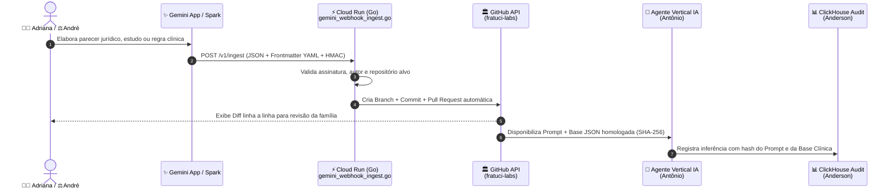

# 🤖 AI Agents Core — Motor de Agentes Verticais & Ponte Gemini-to-GitHub
**Líder Responsável:** 👤 **Antônio — Diretor de Engenharia de IA & Agentes Autônomos**

> [!IMPORTANT]
> **Missão do Repositório:** Transformar o conhecimento jurídico do **André** e o conhecimento clínico/estratégico da **Adriana** em **Agentes Autônomos Auditáveis**, mantendo **Zero Barreira Técnica** para os sócios de negócios e garantindo determinismo, segurança e rastreabilidade total.

---

## 🧠 1. Arquitetura de Agentes Verticais & "Zero Barreira Técnica"

Em empresas tradicionais, especialistas de negócios, saúde e direito dependem de desenvolvedores para atualizar regras de sistema, ou acabam espalhando documentos importantes em pastas de Google Drive e conversas de WhatsApp sem controle de versão.

Na **Fratuci Labs**, criamos a **Ponte Automática Gemini-to-GitHub**:

1. **Conversa Natural no Gemini App / Spark:**
   - A **Adriana** analisa uma nova diretriz da Anvisa ou curadoria de interações medicamentosas conversando com o Gemini.
   - O **André** elabora um parecer sobre a LGPD ou uma cláusula do Protocolo Familiar conversando com o Gemini.
2. **Exportação Estruturada em 1 Clique:**
   - Ao final da conversa, o Gemini formata o resultado com um cabeçalho YAML padronizado e envia para o nosso endpoint serverless [`automation/gemini_webhook_ingest.go`](./automation/gemini_webhook_ingest.go) rodando no Cloud Run do **Anderson**.
3. **Versionamento Automático no GitHub (`fratuci-labs`):**
   - O middleware em Go valida a autenticidade da requisição (HMAC-SHA256), identifica o repositório de destino (`strategy-and-healthtech` ou `legal-governance-as-code`) e cria automaticamente um **Commit** ou **Pull Request** identificado com o nome do autor.
4. **Injeção Determinística nos Agentes (RAG & System Prompts as Code):**
   - Nossos agentes verticais consomem diretamente os arquivos aprovados na branch `main` (como [`pharma-triage-system-prompt.md`](./prompts/pharma-triage-system-prompt.md) e a base JSON da Adriana).

---

## 📂 2. Estrutura do Repositório

| Arquivo | Descrição | Governança |
| :--- | :--- | :--- |
| [`prompts/pharma-triage-system-prompt.md`](./prompts/pharma-triage-system-prompt.md) | System Prompt como Código para o Agente de Triagem Farmacológica e Verificação de Bulas/Interações, com metadados YAML de aprovação jurídica e farmacêutica. | Antônio, Adriana & André |
| [`automation/gemini_webhook_ingest.go`](./automation/gemini_webhook_ingest.go) | Serviço HTTP em Go (pronto para Cloud Run) que recebe resumos do Gemini da Adriana e do André e abre Commits/PRs automaticamente na organização `fratuci-labs`. | Antônio & Anderson |

---

## 🛡️ 3. Ciclo de Vida de um System Prompt na Fratuci Labs

Nenhum System Prompt é embutido diretamente em código-fonte ("hardcoded"). Todo prompt segue o padrão **Prompt-as-Code**:
- **Frontmatter YAML Obrigatório:** Contém `version`, `approved_by_legal`, `approved_by_pharma` e `risk_level`.
- **Hash Criptográfico:** No momento da execução, o motor calcula o SHA-256 do arquivo `.md` e envia para a tabela `fratuci_audit.healthtech_agent_events` no ClickHouse do **Anderson**.
- **Dupla Chave de Segurança:** Alterações em prompts de saúde exigem aprovação explícita da **Adriana** (Farmácia) e do **André** (Jurídico) via Pull Request antes do merge na `main`.
